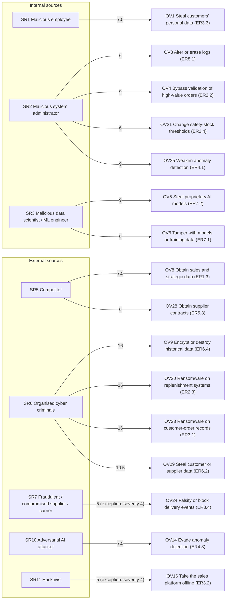

# Workshop 2: Evaluation Criteria, Scoring, Selection and Map of Risk Sources

**Case study:** AI-SCMIS
**Input:** `Risk_Sources_and_Target_Objectives.md` (11 risk sources SR1 to SR11, 33 SR/OV couples, all 31 Workshop 1 feared events reviewed)
**Covers:** Evaluation criteria, scoring grid and relevance, selection of retained SR/OV couples, map of risk sources

---

## 1. Evaluation Criteria

Each SR/OV couple is scored on three criteria, from 1 to 4. The score applies to the couple (the risk source and this specific objective), not to the source in general.

| Level | Motivation (how much the source wants it) | Resources (what the source can do) | Activity (how often it acts in this area) |
|---|---|---|---|
| 1 | Very low | Very limited, no special skills or access | Rare |
| 2 | Low | Limited, basic tools or access | Occasional |
| 3 | Strong | Significant, skilled or privileged access | Frequent |
| 4 | Very strong | Extensive, expert team or full access | Very frequent |

**Relevance rule (project assumption):**

`Relevance = Motivation × (Resources + Activity) / 2` (range 1 to 16)

A low motivation lowers the result even when the source is strong. Because of the division by 2, relevance can be a decimal (for example 7.5).

| Relevance | Level |
|---|---|
| Up to 4.5 | Low |
| Above 4.5 up to 8.5 | Medium |
| Above 8.5 up to 12.5 | High |
| Above 12.5 | Very high |

**Non-malicious sources (SR4, SR8).** These sources act without intent, so Motivation is set to 1. They therefore score low. Whether they stay in the scoring grid or move entirely to the security baseline is an open point for team validation (see section 5).

---

## 2. Scoring Grid and Relevance

Severity comes from the inventory (derived from the Workshop 1 class of the affected asset).

| Couple | ER | M | R | A | Relevance | Level | Sev. | Justification |
|---|---|---|---|---|---|---|---|---|
| SR1-OV1 | ER3.3 | 3 | 3 | 2 | 7.5 | Medium | 3 | Personal data has resale value; an employee already has access; insider theft is occasional. |
| SR1-OV2 | ER3.5 | 2 | 3 | 2 | 5 | Medium | 3 | Altering orders brings less direct gain and is easy to trace. |
| SR2-OV3 | ER8.1 | 2 | 4 | 2 | 6 | Medium | 3 | Erasing logs is a means to hide another action; the admin controls the logs. |
| SR2-OV4 | ER2.2 | 3 | 4 | 2 | 9 | High | 3 | Bypassing validation of large orders gives direct financial gain; the admin controls approvals. |
| SR2-OV21 | ER2.4 | 2 | 4 | 2 | 6 | Medium | 3 | Less direct gain than bypassing validation; the admin has full access to thresholds. |
| SR2-OV25 | ER4.1 | 3 | 4 | 2 | 9 | High | 3 | Direct motive to hide fraud; the admin controls detection rules. |
| SR3-OV5 | ER7.2 | 3 | 4 | 2 | 9 | High | 3 | Stolen models have commercial value; the ML engineer has direct access to the registry. |
| SR3-OV6 | ER7.1 | 2 | 4 | 2 | 6 | Medium | 3 | Sabotaging the own employer's model is rarer than theft; same direct access. |
| SR4-OV7 | ER6.1 | 1 | 3 | 4 | 3.5 | Low | 3 | No intent (accidental error); mistakes are frequent; normal access to data. |
| SR4-OV18 | ER1.1 | 1 | 3 | 2 | 2.5 | Low | 3 | No intent; mislabelling training data is occasional. |
| SR4-OV22 | ER2.4 | 1 | 3 | 3 | 3 | Low | 3 | No intent; configuration mistakes are fairly frequent. |
| SR4-OV26 | ER4.2 | 1 | 3 | 3 | 3 | Low | 3 | No intent; configuration mistakes are fairly frequent. |
| SR4-OV31 | ER8.2 | 1 | 3 | 3 | 3 | Low | 3 | No intent; validation steps are sometimes skipped under pressure. |
| SR4-OV33 | ER8.4 | 1 | 3 | 2 | 2.5 | Low | 2 | No intent; accidental deletion is occasional. |
| SR5-OV8 | ER1.3 | 3 | 2 | 3 | 7.5 | Medium | 2 | Clear commercial motive; data must be obtained from outside; commercial espionage is fairly frequent. |
| SR5-OV28 | ER5.3 | 3 | 2 | 2 | 6 | Medium | 2 | Real motive, but contracts are harder to reach than sales data (borderline). |
| SR6-OV9 | ER6.4 | 4 | 4 | 4 | 16 | Very high | 3 | Financial motive; skilled groups; ransomware against companies is very frequent. |
| SR6-OV20 | ER2.3 | 4 | 4 | 4 | 16 | Very high | 4 | Same ransomware attack as OV9, on the replenishment systems. |
| SR6-OV23 | ER3.1 | 4 | 4 | 4 | 16 | Very high | 4 | Same ransomware attack as OV9, on the customer-order records (class D4). |
| SR6-OV29 | ER6.2 | 3 | 3 | 4 | 10.5 | High | 3 | Data theft for sale or extortion is very common. |
| SR6-OV32 | ER8.3 | 1 | 3 | 3 | 3 | Low | 2 | Logs have little resale value; they are only a step toward another goal. |
| SR7-OV10 | ER5.1 | 2 | 3 | 2 | 5 | Medium | 2 | Limited gain for the supplier; already feeds data into the system; low impact (class I1). |
| SR7-OV24 | ER3.4 | 2 | 3 | 2 | 5 | Medium | 4 | Same logic as OV10, but the impact is critical (class D4). |
| SR8-OV11 | ER6.3 | 1 | 3 | 3 | 3 | Low | 3 | Unintentional failure; the provider controls the infrastructure; outages and breaches occur. |
| SR8-OV19 | ER1.2 | 1 | 3 | 3 | 3 | Low | 3 | Unintentional; same logic as OV11. |
| SR8-OV27 | ER5.2 | 1 | 3 | 3 | 3 | Low | 2 | Unintentional; same logic as OV11. |
| SR9-OV12 | ER7.2 | 1 | 4 | 1 | 2.5 | Low | 3 | Very strong resources, but a regional distributor is not a likely target. |
| SR10-OV13 | ER7.1 | 2 | 3 | 2 | 5 | Medium | 3 | Poisoning inputs needs access to sensors or external feeds, which is difficult. |
| SR10-OV14 | ER4.3 | 3 | 3 | 2 | 7.5 | Medium | 3 | A fraudster has a strong reason to evade detection. |
| SR10-OV15 | ER2.1 | 2 | 3 | 1 | 4 | Low | 3 | The case study describes no chatbot or LLM, so prompt injection is unlikely (assumption). |
| SR10-OV17 | ER1.1 | 2 | 3 | 2 | 5 | Medium | 3 | Same logic as OV13: hard access to inputs. |
| SR10-OV30 | ER7.3 | 2 | 3 | 1 | 4 | Low | 3 | Needs an exposed, queryable model; the case study does not describe one (assumption). |
| SR11-OV16 | ER3.2 | 2 | 2 | 3 | 5 | Medium | 4 | DoS attacks are frequent, but motivation against this company is weak. Severity is critical (D4). |

---

## 3. Selection of Retained SR/OV Couples

**Threshold:** a couple is retained if its relevance is **6 or more**.
**Exception:** a couple below 6 is also retained if its severity is 4 (critical).

Result: **16 retained couples** and **17 excluded couples** (total 33).

### 3.1 Retained couples (16)

| Couple | Relevance | Source | Objective | ER | Why retained |
|---|---|---|---|---|---|
| SR6-OV9 | 16 | Organised cyber criminals | Destroy or encrypt historical data for ransom | ER6.4 | Maximum score; ransomware is frequent. |
| SR6-OV20 | 16 | Organised cyber criminals | Encrypt or disable replenishment systems | ER2.3 | Maximum score; critical impact (D4). |
| SR6-OV23 | 16 | Organised cyber criminals | Encrypt or destroy customer-order records | ER3.1 | Maximum score; critical impact (D4). |
| SR6-OV29 | 10.5 | Organised cyber criminals | Steal customer or supplier data for sale or extortion | ER6.2 | Data theft for extortion is very common. |
| SR2-OV4 | 9 | Malicious system administrator | Bypass human validation of high-value orders | ER2.2 | Direct financial gain; the admin controls approvals. |
| SR2-OV25 | 9 | Malicious system administrator | Disable or weaken anomaly detection to hide fraud | ER4.1 | Direct motive to hide fraud. |
| SR3-OV5 | 9 | Malicious data scientist / ML engineer | Steal the proprietary AI models | ER7.2 | Model theft is a top concern (class C3). |
| SR1-OV1 | 7.5 | Malicious employee | Steal or disclose customers' personal data | ER3.3 | Insider has easy access to personal data. |
| SR5-OV8 | 7.5 | Competitor | Obtain historical sales and strategic data | ER1.3 | Clear commercial motive. |
| SR10-OV14 | 7.5 | Adversarial AI attacker | Craft inputs that evade anomaly detection | ER4.3 | Strong reason to evade the detection model. |
| SR2-OV3 | 6 | Malicious system administrator | Alter or erase logs to hide malicious activity | ER8.1 | The admin controls the logs and can hide other attacks. |
| SR2-OV21 | 6 | Malicious system administrator | Change safety-stock thresholds without authorisation | ER2.4 | At the threshold; the admin can cause stockouts or excess stock. |
| SR3-OV6 | 6 | Malicious data scientist / ML engineer | Tamper with models or training data | ER7.1 | Covers the data and model poisoning risk (ED-IA1, ED-IA2). |
| SR5-OV28 | 6 | Competitor | Obtain supplier contracts and commercial conditions | ER5.3 | At the threshold (borderline); to be discussed. |
| SR11-OV16 | 5 | Hacktivist | Take the sales platform and order API offline | ER3.2 | Exception: severity 4 (class D4). |
| SR7-OV24 | 5 | Fraudulent / compromised supplier / carrier | Falsify or block delivery events to delay deliveries | ER3.4 | Exception: severity 4 (class D4). |

### 3.2 Attack families (for Workshop 3)

| Family | Retained couples |
|---|---|
| Ransomware | SR6-OV9, SR6-OV20, SR6-OV23 |
| Data theft | SR1-OV1, SR5-OV8, SR5-OV28, SR6-OV29 |
| Administrator abuse | SR2-OV3, SR2-OV4, SR2-OV21, SR2-OV25 |
| AI model attacks | SR3-OV5, SR3-OV6 |
| Evasion of detection | SR10-OV14 |
| Denial of service and delivery disruption | SR11-OV16, SR7-OV24 |

### 3.3 Excluded couples (17)

| Couple | Relevance | Reason for exclusion | Handled in |
|---|---|---|---|
| SR1-OV2 | 5 | Lower motivation; order alteration is easy to trace. | Security baseline (access control, logging) |
| SR7-OV10 | 5 | Low impact (ER5.1, class I1). | Supplier contracts |
| SR10-OV13 | 5 | Needs hard access to inputs; the risk is covered by SR3-OV6. | SR3-OV6 and data-quality controls |
| SR10-OV17 | 5 | Same reason as SR10-OV13. | SR3-OV6 and data-quality controls |
| SR10-OV15 | 4 | No chatbot or LLM in the case study. | Re-assess if an LLM is added |
| SR10-OV30 | 4 | No exposed, queryable model described. | Re-assess if the model is exposed |
| SR4-OV7 | 3.5 | Accidental error, no intent. | Security baseline (ED-H1) |
| SR4-OV18 | 2.5 | Accidental error, no intent. | Security baseline (ED-H5) |
| SR4-OV22 | 3 | Accidental error, no intent. | Security baseline (ED-H2) |
| SR4-OV26 | 3 | Accidental error, no intent. | Security baseline (ED-H2) |
| SR4-OV31 | 3 | Accidental error, no intent. | Security baseline (ED-H4) |
| SR4-OV33 | 2.5 | Accidental error, no intent. | Security baseline (ED-H3) |
| SR8-OV11 | 3 | Unintentional failure of a provider. | Supplier contracts, business continuity plan |
| SR8-OV19 | 3 | Unintentional failure of a provider. | Supplier contracts, business continuity plan |
| SR8-OV27 | 3 | Unintentional failure of a provider. | Supplier contracts, business continuity plan |
| SR9-OV12 | 2.5 | A state actor has no interest in a regional distributor. | Not handled; low relevance |
| SR6-OV32 | 3 | Logs have little value for criminals; only a step toward another goal. | Access control and phishing awareness |

---

## 4. Map of Risk Sources

The map shows the 16 retained couples. The number on each arrow is the relevance score. The ER in brackets is the Workshop 1 feared event.

Sources without a retained couple (not on the map): SR4, SR8, SR9.

---

## 5. Assumptions and Open Points

- The 1 to 4 scale and the relevance rule are project assumptions agreed between Person A and Person B. Both are still to be validated by the team.
- Severity is the value from the inventory, derived from the Workshop 1 class of the affected asset.
- The scores are team judgments, not measured data. They can be revised if the professor or Workshop 3 provides evidence.
- **Non-malicious sources (SR4, SR8):** the motivation scale does not fit sources without intent. They are scored with Motivation 1 and fall below the threshold. The team should decide whether they stay in the scoring grid or are handled only in the security baseline.
- **Ransomware couples:** SR6-OV9, SR6-OV20 and SR6-OV23 describe the same attack on different assets. Workshop 3 could merge them into one scenario.
- **Borderline couples:** SR5-OV28 and SR2-OV21 are retained exactly at the threshold of 6.
- SR10-OV15 (prompt injection) and SR10-OV30 (model inversion) are excluded because the case study describes no LLM or exposed model. Re-assess if the system changes.
- ER7.4 (undetected model drift) has no SR/OV couple, as documented in the inventory.
- Evidence requirements for Workshop 2 are still to be confirmed with the professor.
- The retained couples are the input of Workshop 3.
