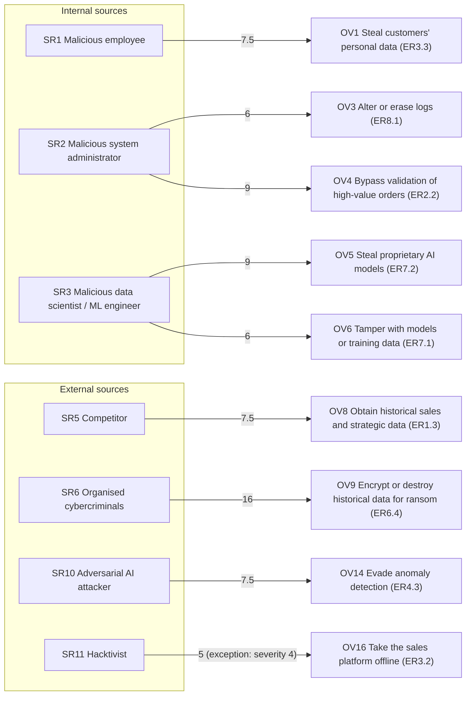

# Workshop 2: Criteria, Scoring, Selection and Map

**Case study:** AI-SCMIS
**Input:** `Risk Sources and Target Objectives.md` (11 sources SR1 to SR11, 16 SR/OV couples)
**Covers:** Task 3 (criteria), Task 4 (scoring grid), Task 5 (selection), Task 6 (map)

---

## 1. Evaluation Criteria

Each SR/OV couple is scored on three criteria, from 1 to 4. The score applies to the couple (the source and this specific objective), not to the source in general.

| Level | Motivation (how much the source wants it) | Resources (what the source can do) | Activity (how often it acts in this area) |
|---|---|---|---|
| 1 | Very low | Very limited, no special skills or access | Rare |
| 2 | Low | Limited, basic tools or access | Occasional |
| 3 | Strong | Significant, skilled or privileged access | Frequent |
| 4 | Very strong | Extensive, expert team or full access | Very frequent |

**Relevance rule (project assumption):**

`Relevance = Motivation × (Resources + Activity) / 2` (range 1 to 16)

A low motivation lowers the result even when the source is strong.

| Relevance | Level |
|---|---|
| 1 to 4 | Low |
| 5 to 8 | Medium |
| 9 to 12 | High |
| 13 to 16 | Very high |

---

## 2. Scoring Grid and Relevance

Severity comes from the inventory (derived from the Workshop 1 class of the affected asset).

| Couple | M | R | A | Relevance | Level | Sev. | Justification |
|---|---|---|---|---|---|---|---|
| SR1-OV1 | 3 | 3 | 2 | 7.5 | Medium | 3 | Personal data has resale value; an employee already has access; insider theft is occasional. |
| SR1-OV2 | 2 | 3 | 2 | 5 | Medium | 3 | Altering orders brings less direct gain and is easy to trace. |
| SR2-OV3 | 2 | 4 | 2 | 6 | Medium | 3 | Erasing logs is a means to hide another action; the admin controls the logs. |
| SR2-OV4 | 3 | 4 | 2 | 9 | High | 3 | Bypassing validation of large orders gives direct financial gain; the admin controls approvals. |
| SR3-OV5 | 3 | 4 | 2 | 9 | High | 3 | Stolen models have commercial value; the ML engineer has direct access to the registry. |
| SR3-OV6 | 2 | 4 | 2 | 6 | Medium | 3 | Sabotaging own employer's model is rarer than theft; same direct access. |
| SR4-OV7 | 1 | 3 | 4 | 3.5 | Low | 3 | No intent (accidental error); mistakes are frequent; normal access to data. |
| SR5-OV8 | 3 | 2 | 3 | 7.5 | Medium | 2 | Clear commercial motive; data must be obtained from outside; commercial espionage is fairly frequent. |
| SR6-OV9 | 4 | 4 | 4 | 16 | Very high | 3 | Financial motive; skilled groups; ransomware against companies is very frequent. |
| SR7-OV10 | 2 | 3 | 2 | 5 | Medium | 2 | Limited gain for the supplier; already feeds data into the system; low impact (class I1). |
| SR8-OV11 | 1 | 3 | 3 | 3 | Low | 3 | Unintentional failure; provider controls the infrastructure; outages and breaches do occur. |
| SR9-OV12 | 1 | 4 | 1 | 2.5 | Low | 3 | Very strong resources, but a regional distributor is not a likely target. |
| SR10-OV13 | 2 | 3 | 2 | 5 | Medium | 3 | Poisoning inputs needs access to sensors or external feeds, which is difficult. |
| SR10-OV14 | 3 | 3 | 2 | 7.5 | Medium | 3 | A fraudster has a strong reason to evade detection. |
| SR10-OV15 | 2 | 3 | 1 | 4 | Low | 3 | The case study describes no chatbot or LLM, so prompt injection is unlikely (assumption). |
| SR11-OV16 | 2 | 2 | 3 | 5 | Medium | 4 | DoS attacks are frequent, but motivation against this company is weak. Severity is critical (D4). |

---

## 3. Selection of Retained SR/OV Couples

**Threshold:** a couple is retained if its relevance is **6 or more**.
**Exception:** a couple below 6 is also retained if its severity is 4 (critical).

### 3.1 Retained couples (9)

| Couple | Relevance | Source | Objective | Feared event | Why retained |
|---|---|---|---|---|---|
| SR6-OV9 | 16 | Organised cybercriminals | Encrypt or destroy historical data for ransom | ER6.4 | Maximum score; ransomware is frequent and the loss is serious. |
| SR2-OV4 | 9 | Malicious system administrator | Bypass human validation of high-value orders | ER2.2 | Direct financial gain; the admin controls approvals. |
| SR3-OV5 | 9 | Malicious data scientist / ML engineer | Steal the proprietary AI models | ER7.2 | Model theft is a top concern (class C3). |
| SR1-OV1 | 7.5 | Malicious employee | Steal or disclose customers' personal data | ER3.3 | Insider has easy access to personal data. |
| SR5-OV8 | 7.5 | Competitor | Obtain historical sales and strategic data | ER1.3 | Clear commercial motive. |
| SR10-OV14 | 7.5 | Adversarial AI attacker | Craft inputs that evade anomaly detection | ER4.3 | Strong reason to evade the detection model. |
| SR2-OV3 | 6 | Malicious system administrator | Alter or erase logs to hide malicious activity | ER8.1 | The admin controls the logs and can hide other attacks. |
| SR3-OV6 | 6 | Malicious data scientist / ML engineer | Tamper with models or training data | ER7.1 | Covers the data and model poisoning risk (ED-IA1, ED-IA2). |
| SR11-OV16 | 5 | Hacktivist | Take the sales platform and order API offline | ER3.2 | Exception: severity 4 (class D4). |

### 3.2 Excluded couples (7)

| Couple | Relevance | Reason for exclusion | Handled in |
|---|---|---|---|
| SR1-OV2 | 5 | Lower motivation; order alteration is easy to trace. | Security baseline (access control, logging) |
| SR7-OV10 | 5 | Low impact (ER5.1, class I1). | Supplier contracts |
| SR10-OV13 | 5 | Needs hard access to inputs; the risk is covered by SR3-OV6. | SR3-OV6 and data-quality controls |
| SR10-OV15 | 4 | No chatbot or LLM in the case study. | Re-assess if an LLM is added |
| SR4-OV7 | 3.5 | Accidental error, no intent. | Security baseline (ED-H1) |
| SR8-OV11 | 3 | Unintentional failure of a provider. | Supplier contracts, business continuity plan |
| SR9-OV12 | 2.5 | A state actor has no interest in a regional distributor. | Not handled; low relevance |

---

## 4. Map of Risk Sources

The map shows the 9 retained couples. The number on each arrow is the relevance score. The ER in brackets is the Workshop 1 feared event.

Sources without a retained couple (not on the map): SR4, SR7, SR8, SR9.

---

## 5. Assumptions and Open Points

- The 1 to 4 scale and the relevance rule are project assumptions and were agreed between Person A and Person B.
- Severity is the value from the inventory, derived from the Workshop 1 class of the affected asset.
- The scores are team judgments, not measured data. They can be revised if the professor or Workshop 3 provides evidence.
- Evidence requirements for Workshop 2 are still to be confirmed with the professor.
- SR10-OV15 (prompt injection) is excluded because the case study has no LLM or chatbot. It should be re-assessed if one is added.
- Retained couples are the input of Workshop 3.
