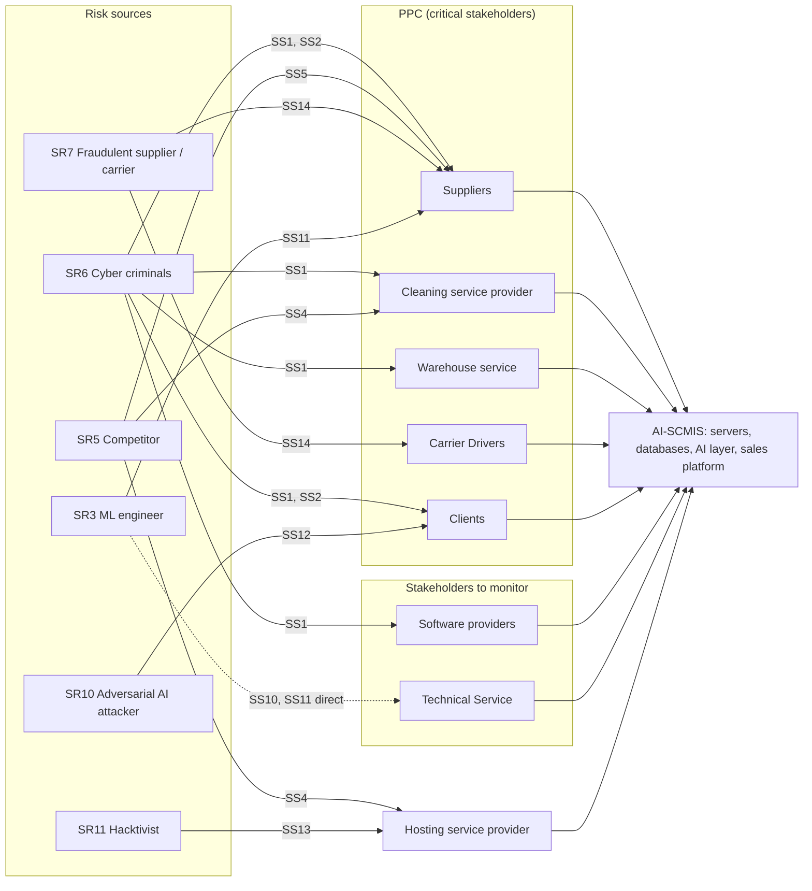

# Workshop 3 – Strategic Scenarios

## 1. Define the Digital Ecosystem

The system under study is an AI-enabled Supply Chain Management Information System (AI-SCMIS) consisting of:

- Workstations equipped with monitoring and management dashboards of the AI-SCMIS system.
- Local server that runs the local services, databases, and data warehouse.
- Local server that runs the AI layer of the system.
- Local network (Wi-Fi & Ethernet) connecting the different parts of the system.
- IoT devices to control and monitor warehouses and carriers.
- Internet connection linking the internal system to external information sources.

The main actors of this ecosystem are:

- Internal Employees (Administration, Warehouse service, Carrier drivers).
- Clients and Partners (External clients, Suppliers).
- Technical Service Providers (Web hosting service provider, External API providers: weather, suppliers, route status).
- Software Providers (ERP, WMS, etc.).
- Suppliers of technical equipment.

### 1.1 Stakeholders Identification

| Category | Stakeholder | Interaction with the System |
| --- | --- | --- |
| Internal | Administration | Monitor the system and metrics reporting work status. |
|  | Warehouse service | Manage data related to goods, stocks, and orders. |
|  | Finance & accountants service | Manage & monitor financial data inside the system. |
|  | Sales Service | Manage clients & order-related data. |
|  | Carrier Drivers | Provide delivery data. |
|  | Information system Admin (DSI) | Configure the system and its equipment; manage other stakeholders' roles and access levels. |
|  | Technical Service (Engineers) | Design, implement, and develop the AI layer of the system. |
|  | Website management service | Manage the sales website of the company. |
| External | Clients | Explore the company website and place orders. |
|  | Suppliers | Provide information to the system. |
|  | Software providers | Provide software (ERP, WMS, etc.). |
|  | Hosting service provider | Hosts the company website. |
|  | Other competitor spare parts companies | May spy, attack, or alter information inside the company system. |
|  | Cleaning service provider | Have physical access to IT infrastructure; may cause corruption or tampering. |

### 1.2 Threat Level Evaluation

#### Evaluation Factors and Scale
Stakeholder evaluation depends on two factors rated on a 1-to-6 scale (**1–2: Weak / 3–4: Moderate / 5–6: High**):
1. **Exposure:** Level of access the stakeholder has to the study object (AI-SCMIS).
2. **Cyber Reliability:** How much the company can trust the stakeholder and their level of cybersecurity awareness.

#### Threat Level Calculation and Classification
$$\text{Threat Level} = \frac{\text{Exposure}}{\text{Cyber Reliability}}$$

- A ratio of **1** means the stakeholder's access matches the trust the company can give them.
- A ratio **above 1** means the stakeholder has more access than the company can trust them with.
- The higher the ratio, the higher the threat.

| Threat Level (Ratio) | Zone | Meaning |
| --- | --- | --- |
| >= 2 | Critical | Exposure is at least double the reliability. The stakeholder is a critical stakeholder (PPC). |
| > 1 and < 2 | Watch | Exposure is higher than reliability. The stakeholder is monitored. |
| <= 1 | Acceptable | Reliability matches or exceeds exposure. |

#### Stakeholder Threat Evaluation Grid

| Stakeholder | Exposure | Cyber Reliability | Threat Level | Zone | Main Threat & Observation |
| --- | :---: | :---: | :---: | --- | --- |
| Suppliers | 4 | 1 | 4.00 | Critical | Falsified or wrong data (stocks, prices, delays) misleads AI decisions. A compromised supplier account can serve as an entry point. |
| Cleaning service provider | 3 | 1 | 3.00 | Critical | Physical access to servers, network equipment, and workstations: theft, corruption, rogue USB device, accidental unplugging. |
| Warehouse service | 2 | 1 | 2.00 | Critical | Wrong data entry, unintentional leak of warehouse information, misuse of IoT devices. |
| Carrier Drivers | 2 | 1 | 2.00 | Critical | Falsified delivery data, lost or stolen mobile devices and IoT trackers. |
| Clients | 2 | 1 | 2.00 | Critical | Fraudulent orders, account takeover, attacks through the sales website used as an entry point. |
| Sales Service | 4 | 3 | 1.33 | Watch | Leak of client data, loss of clients, phishing. |
| Information system Admin (DSI) | 6 | 5 | 1.20 | Watch | Compromise of a privileged account gives full control over the system. |
| Technical Service (Engineers) | 6 | 5 | 1.20 | Watch | Design errors, tampering with the AI layer, insecure deployment affecting all dependent services. |
| Software providers | 6 | 5 | 1.20 | Watch | Supply chain attack through malicious updates or vulnerable ERP/WMS components. |
| Administration | 5 | 5 | 1.00 | Acceptable | Deep access to company information; targeted phishing of managers, leak of sensitive information. |
| Finance & accountants service | 3 | 3 | 1.00 | Acceptable | Exposure to critical financial data; financial fraud, theft of financial data. |
| Website management service | 5 | 5 | 1.00 | Acceptable | Wrong configuration exposing sensitive information to the public. |
| Hosting service provider | 5 | 5 | 1.00 | Acceptable | Provider outage or breach leading to data exposure and website unavailability. |
| Other competitor spare parts companies | 1 | 1 | 1.00 | Special case | High source of threat: espionage, intrusion, alteration of information. |

- **Note on competitors:** Competitors are not a normal stakeholder; they have no legitimate access to the system but intend to harm the company, so the ratio does not reflect their threat. They are treated as a **risk source**, not rated by the ratio.
- **Note on external API providers:** External API providers (weather, traffic/route status, suppliers) feed data to the AI layer and carry a data integrity risk similar to suppliers; they are considered alongside **Suppliers**.

---

## 2. Identify Critical Stakeholders

The Critical Stakeholders (**PPC – Parties Prenantes Critiques**) are the actors in the **Critical zone** (Threat level >= 2).

| PPC | Threat Level | Why It Is Critical | Possible Security Measures |
| --- | :---: | --- | --- |
| Suppliers | 4.00 | Significant access to the system (4/6) with very low cyber reliability (1/6). Wrong or falsified data directly falsifies AI decisions. | Validation and anomaly detection of supplier data, authenticated APIs, security clauses in contracts. |
| Cleaning service provider | 3.00 | Physical access to IT infrastructure with no cybersecurity awareness. | Locked server room, supervised or scheduled access, access logs, disabled USB ports. |
| Warehouse service | 2.00 | Manages goods, stocks, and orders data without cybersecurity awareness, making errors and leaks likely. | Awareness training, input controls, least privilege access. |
| Carrier Drivers | 2.00 | Provide delivery data (risk of falsification) and use mobile devices outside the company. | Strong authentication on mobile apps, cross-checking with IoT/GPS data, remote wipe of lost devices. |
| Clients | 2.00 | Use the internet-facing website, which can be abused for fraud or as an entry point to the system. | Web application firewall, rate limiting, strong authentication, separation of the website from the internal network. |

### Stakeholders to Monitor & Summary
- **5 PPCs:** Suppliers, Cleaning service provider, Warehouse service, Carrier Drivers, Clients.
- **3 Stakeholders to Monitor (High Impact):** **DSI**, **Technical Service (Engineers)**, and **Software providers** fall into the Watch zone because of high reliability, but they hold maximum exposure (6/6)—any compromise would have a major system-wide impact.
- **1 Risk Source:** Competitor spare parts companies (kept as a risk source, not a PPC).

---

## 3. Construct Strategic Scenarios

A strategic scenario describes how a **risk source** reaches its **target objective (OV)** and causes a **feared event (ER)** from Workshop 1 by following a path in the ecosystem:
- **Direct path:** The risk source reaches the target on its own (direct attack or legitimate insider access) without using a stakeholder as a relay.
- **Indirect path:** The risk source passes through an ecosystem stakeholder (PPC or stakeholder to monitor) used as a relay, entry point, or source of falsified data.

The **16 retained SR/OV couples** from Workshop 2 are consolidated into **14 strategic scenarios** (merging the three ransomware couples `SR6-OV9`, `SR6-OV20`, and `SR6-OV23` into `SS1`).

| Scenario | Family (Workshop 2) | Risk Source | Target Objective (OV) | Feared Event (ER) | Couple(s) | Relevance (W2) |
| --- | --- | --- | --- | --- | --- | --- |
| SS1 | Ransomware | SR6 Organised cyber criminals | OV9, OV20, OV23: encrypt or destroy historical data, replenishment systems, and customer-order records | ER6.4, ER2.3, ER3.1 | SR6-OV9, SR6-OV20, SR6-OV23 | 16 |
| SS2 | Data theft | SR6 Organised cyber criminals | OV29: steal customer or supplier data for sale or extortion | ER6.2 | SR6-OV29 | 10.5 |
| SS3 | Data theft | SR1 Malicious employee | OV1: steal or disclose customers' personal data | ER3.3 | SR1-OV1 | 7.5 |
| SS4 | Data theft | SR5 Competitor | OV8: obtain historical sales and strategic data | ER1.3 | SR5-OV8 | 7.5 |
| SS5 | Data theft | SR5 Competitor | OV28: obtain supplier contracts and commercial conditions | ER5.3 | SR5-OV28 | 6 |
| SS6 | Administrator abuse | SR2 Malicious system administrator | OV4: bypass human validation of high-value orders | ER2.2 | SR2-OV4 | 9 |
| SS7 | Administrator abuse | SR2 Malicious system administrator | OV25: disable or weaken anomaly detection to hide fraud | ER4.1 | SR2-OV25 | 9 |
| SS8 | Administrator abuse | SR2 Malicious system administrator | OV3: alter or erase logs to hide malicious activity | ER8.1 | SR2-OV3 | 6 |
| SS9 | Administrator abuse | SR2 Malicious system administrator | OV21: change safety-stock thresholds without authorisation | ER2.4 | SR2-OV21 | 6 |
| SS10 | AI model attacks | SR3 Malicious data scientist / ML engineer | OV5: steal the proprietary AI models | ER7.2 | SR3-OV5 | 9 |
| SS11 | AI model attacks | SR3 Malicious data scientist / ML engineer | OV6: tamper with models or training data | ER7.1 | SR3-OV6 | 6 |
| SS12 | Evasion of detection | SR10 Adversarial AI attacker | OV14: craft inputs that evade anomaly detection | ER4.3 | SR10-OV14 | 7.5 |
| SS13 | Denial of service & delivery disruption | SR11 Hacktivist | OV16: take the sales platform and order API offline | ER3.2 | SR11-OV16 | 5 (exception: severity 4) |
| SS14 | Denial of service & delivery disruption | SR7 Fraudulent / compromised supplier / carrier | OV24: falsify or block delivery events to delay deliveries | ER3.4 | SR7-OV24 | 5 (exception: severity 4) |

### 3.1 Direct & Indirect Attack Paths

Each path follows the sequence: **Risk source → Entry point / Relay → Supporting asset reached → Feared event**.

| Scenario | Direct Path | Indirect Path(s) via Ecosystem Stakeholders |
| --- | --- | --- |
| **SS1** Ransomware | SR6 → attack on an exposed service or remote access of local servers → encryption of database/data warehouse server, AI server, and ERP/WMS → ER6.4, ER2.3, ER3.1. | (a) **Software providers**: malicious or vulnerable ERP/WMS update → servers → ER2.3, ER3.1. (b) **Cleaning service provider**: rogue USB device or physical access to server room → local server → ER6.4. (c) **Clients**: attack through sales website and order API → internal network → ER3.1. (d) **Suppliers**: compromised supplier account or portal → integration service → databases → ER6.4. (e) **Warehouse service / Sales Service**: phishing → workstation → local network → ER2.3. |
| **SS2** Data theft by criminals | SR6 → intrusion on operational database and data warehouse → exfiltration of customer and supplier data → extortion or sale → ER6.2. | (a) **Clients**: account takeover on sales website → customer data → ER6.2. (b) **Sales Service**: phishing of workstation with access to client data → ER6.2. (c) **Suppliers**: compromised supplier account → supplier data → ER6.2. (d) **Hosting service provider**: breach of hosted website → exposed data → ER6.2. |
| **SS3** Malicious employee, personal data | SR1 (legitimate access to order and customer data) → copy of customer data (USB, email, export) → disclosure or sale → ER3.3. | None identified. The insider uses existing access. |
| **SS4** Competitor, sales & strategic data | SR5 → intrusion on sales platform or internal network → historical sales data → ER1.3. | (a) **Sales Service**: targeted phishing or approach of an employee → sales data → ER1.3. (b) **Hosting service provider**: breach of hosting environment → ER1.3. (c) **Cleaning service provider**: physical access to workstations or servers → ER1.3. |
| **SS5** Competitor, supplier contracts | SR5 → intrusion on ERP / procurement data → supplier contracts and conditions → ER5.3. | (a) **Suppliers**: contract information obtained through a supplier or its account → ER5.3. (b) **Administration**: targeted phishing of a manager holding contracts → ER5.3. (c) **Software providers**: weakness in ERP storing contracts → ER5.3. |
| **SS6** Administrator bypasses validation | SR2 (DSI, full control over roles and access levels) → changes approval rules or role rights → high-value orders pass without human validation → ER2.2. | Variant for Workshop 4: collusion with a **Supplier** contact to place unchecked orders. |
| **SS7** Administrator weakens detection | SR2 (DSI) → changes configuration or rules of anomaly detection service → fraud goes unflagged → ER4.1. | Through **Technical Service (Engineers)**: administrator uses their access to the AI layer to disable or weaken the model. |
| **SS8** Administrator alters logs | SR2 (DSI) → privileged access to logging system → alteration or deletion of decision and activity logs → ER8.1. | None identified. The administrator controls logs directly. |
| **SS9** Administrator changes thresholds | SR2 (DSI) → ERP / inventory configuration → safety-stock thresholds changed → ER2.4. | None identified. The administrator uses own access. |
| **SS10** Engineer steals models | SR3 (Technical Service) → access to model registry and training pipeline → copy of models outside the company → ER7.2. | None identified. The engineer uses existing access. |
| **SS11** Engineer tampers with models | SR3 (Technical Service) → model registry or training pipeline → modified models or poisoned training data → ER7.1. | Through **Suppliers and external API providers**: falsified input data used as cover or vector for poisoning training data → ER7.1. |
| **SS12** Evasion of detection | SR10 → crafted valid-looking orders submitted through public sales platform and order API → anomaly detection fails to flag them → ER4.3. | (a) **Clients**: fraudulent or taken-over client accounts submit crafted orders. (b) **Suppliers / Carrier Drivers**: falsified data entered through their interfaces hides abnormal patterns. |
| **SS13** Hacktivist denial of service | SR11 → traffic flood on sales website and order API → platform unavailable → ER3.2. | **Hosting service provider**: attack on shared hosting infrastructure of the website → ER3.2. |
| **SS14** Delivery disruption | SR7 (supplier or carrier via authorised interface) → falsified or blocked delivery events sent to system → false delays or missing data → ER3.4. | (a) **Carrier Drivers**: lost, stolen, or manipulated mobile devices and IoT trackers send false data. (b) **Suppliers and external API providers** (route status): compromised feed provides false data. |

#### Ecosystem Attack Path Map (Indirect Paths)



### 3.2 Gravity Assessment

#### Gravity Scale
Gravity measures the impact if the scenario is fully achieved, derived from Workshop 1 asset classes (`C2 = 2`, `C3 = 3`, `I1 = 2`, `I2 = 3`, `D2 = 2`, `D3 = 3`, `D4 = 4`). Where a scenario triggers multiple feared events (e.g., `SS1`), the **highest severity** determines its gravity.

| Gravity | Level | Meaning |
| --- | --- | --- |
| G1 | Minor | Negligible consequences absorbed by normal operations (no scenario at this level). |
| G2 | Significant | Limited consequences the company can absorb or correct (C2, I1, or D2). |
| G3 | Serious | Important losses or damage to business, data, or reputation (C3, I2, or D3). |
| G4 | Critical | Major impact on business continuity (D4 – near-continuous availability required). |

#### Prioritized Gravity Assessment (Input for Workshop 4)

| Rank | Scenario | Feared Event(s) | Gravity | Relevance (W2) | Source | Main Relays & Justification |
| :---: | --- | --- | :---: | :---: | --- | --- |
| 1 | **SS1** Ransomware | ER6.4 (3), ER2.3 (4), ER3.1 (4) | **G4** | 16 | SR6 | Relays: Software providers, Cleaning, Clients, Suppliers, Warehouse. Halts purchasing/orders (D4) and destroys history. |
| 2 | **SS13** Denial of service on sales platform | ER3.2 (4) | **G4** | 5 | SR11 | Relay: Hosting provider. Interrupts order management and revenue (D4). |
| 3 | **SS14** Falsified / blocked delivery events | ER3.4 (4) | **G4** | 5 | SR7 | Relays: Carrier Drivers, Suppliers. Disrupts order & delivery service (D4). |
| 4 | **SS2** Data theft and extortion | ER6.2 (3) | **G3** | 10.5 | SR6 | Relays: Clients, Sales Service, Suppliers, Hosting. Discloses C3 data; legal & trust impact. |
| 5 | **SS6** Bypass of order validation | ER2.2 (3) | **G3** | 9 | SR2 | Direct (DSI). Causes unauthorised financial commitments (I2). |
| 6 | **SS7** Weakening of anomaly detection | ER4.1 (3) | **G3** | 9 | SR2 | DSI, Technical Service. Fraud goes undetected; financial/inventory losses (I2). |
| 7 | **SS10** Theft of AI models | ER7.2 (3) | **G3** | 9 | SR3 | Direct (Technical Service). Loss of proprietary intellectual property (C3). |
| 8 | **SS3** Employee data theft | ER3.3 (3) | **G3** | 7.5 | SR1 | Direct only. Disclosure of customer personal data (C3). |
| 9 | **SS12** Evasion of anomaly detection | ER4.3 (3) | **G3** | 7.5 | SR10 | Relays: Clients, Suppliers, Carrier Drivers. Harmful activity stays undetected (I2). |
| 10 | **SS8** Alteration of logs | ER8.1 (3) | **G3** | 6 | SR2 | Direct (DSI). Loss of audit evidence (I2) and concealment of other attacks. |
| 11 | **SS9** Change of safety-stock thresholds | ER2.4 (3) | **G3** | 6 | SR2 | Direct (DSI). Causes stockouts or excess stock (I2). |
| 12 | **SS11** Tampering with models / training data | ER7.1 (3) | **G3** | 6 | SR3 | Technical Service, Suppliers. Biased/poisoned models corrupt all decisions (I2). |
| 13 | **SS4** Competitor, sales data | ER1.3 (2) | **G2** | 7.5 | SR5 | Relays: Sales Service, Hosting, Cleaning. Loss of competitive advantage (C2). |
| 14 | **SS5** Competitor, supplier contracts | ER5.3 (2) | **G2** | 6 | SR5 | Relays: Suppliers, Administration, Software providers. Loss of negotiating power (C2). |

**Result:** 3 scenarios at **G4** (`SS1`, `SS13`, `SS14`), 9 at **G3**, 2 at **G2**, and 0 at **G1**. All 5 PPCs, all 3 stakeholders to monitor, and all 16 retained couples from Workshop 2 are covered.

#### Assumptions and Open Points
- Attack paths are hypotheses derived from the case study; technical steps and vulnerabilities are detailed in Workshop 4.
- The G1–G4 gravity scale reuses Workshop 2 severity mappings (`C2=2, C3=3, I1=2, I2=3, D2=2, D3=3, D4=4`), which should be confirmed in Workshop 1.
- Network segmentation between the sales website and internal network is not specified in the case study, affecting indirect paths through Clients and the Hosting provider (`SS1`, `SS2`, `SS13`).
- `ER1.4` and `ER7.4` (no SR/OV couple) and excluded Workshop 2 couples (`SR4`, `SR8`, etc.) remain handled in the security baseline and supplier contracts.
````[cite: 1, 2, 3]
