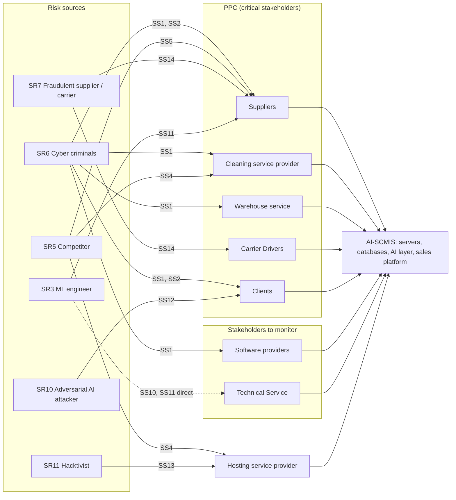

# Workshop 3 - Strategic Scenarios

# 1. Ecosystem Definition:

The system under study is an AI-enabled Supply Chain Management Information System (AI-SCMIS) consists of an information system consists of:

- Work stations equipped with monitoring and management dashboards of the AI-SCMIS system.
- Local server that runs the local services and the databases and data warehouse.
- Local server that runs the AI layer of the system.
- Local network (Wi-Fi & Ethernet) to connect the different parts of the system.
- IoT devices to control and monitor warehouse and carriers.
- Internet connection to connect the internal system to external information sources.

The main actors of this system are:

- Internal Employees (Administration, Warehouse sevice, Carrier drivers).
- Clients and Partners (External clients, Suppliers).
- Technical Service Providers (Web Hosting service provider, External API providers: Weather, Suppliers, route status)
- Software Providers (ERP, WMS,…).
- Suppliers of technical equipment.

# 2. Definition of System Stakeholders

| Category | Stakeholder | Interaction with The system |
| --- | --- | --- |
| Internal | Administration | Monitor the system and metrics reporting work status. |
|  | Warehouse service | Manage data related goods, stocks and orders. |
|  | Finance & accountants service | Manage & Monitor financial data inside the system. |
|  | Sales Service | Manage clients & orders related data |
|  | Carrier Drivers | Provide delivery data |
|  | Information system Admin (DSI) | Configure the system and its  equipment and Manage other stake holders roles and access level. |
|  | Technical Service (Engineers) | Design & implement & Develop the AI layer of the system. |
|  | Website management service | Manage the sales website of the company |
| External | Clients | Explores Company website and place orders. |
|  | Suppliers | Provide Information to the system. |
|  | Software providers | Provide Softwares (ERP, WMS, …) |
|  | Hosting service provider | Hosts the company website. |
|  | Other competitor spare parts companies | They may spy, attack, or alter information inside the company system. |
|  | Cleaning service provider | They have physical access to IT infrastructure, they may cause a corruption. |

# 3. Threat Evaluation of Each Actor

The threat level of each stakeholder is calculated from the two factors evaluated in the previous section:

**Threat level = Exposure / Cyber Reliability**

- A ratio of **1** means the access the stakeholder has matches the trust the company can give them.
- A ratio **above 1** means the stakeholder has more access than the company can trust them with.
- The higher the ratio, the higher the threat.

The classification used:

| Threat level (ratio) | Zone | Meaning |
| --- | --- | --- |
| >= 2 | Critical | Exposure is at least double the reliability. The stakeholder is a critical stakeholder (PPC). |
| > 1 and < 2 | Watch | Exposure is higher than reliability. The stakeholder is monitored. |
| <= 1 | Acceptable | Reliability matches or exceeds exposure. |

| Stakeholder | Exposure | Cyber Reliability | Threat level | Zone | Main threat |
| --- | --- | --- | --- | --- | --- |
| Administration | 5 | 5 | 1.00 | Acceptable | Targeted phishing of managers, leak of sensitive information. |
| Warehouse service | 2 | 1 | 2.00 | Critical | Wrong data entry, unintentional leak of warehouse information, misuse of IoT devices. |
| Finance & accountants service | 3 | 3 | 1.00 | Acceptable | Financial fraud, theft of financial data. |
| Sales Service | 4 | 3 | 1.33 | Watch | Leak of client data, loss of clients, phishing. |
| Carrier Drivers | 2 | 1 | 2.00 | Critical | Falsified delivery data, lost or stolen mobile devices and IoT trackers. |
| Information system Admin (DSI) | 6 | 5 | 1.20 | Watch | Compromise of a privileged account gives full control of the system. |
| Technical Service (Engineers) | 6 | 5 | 1.20 | Watch | Design errors, tampering with the AI layer, insecure deployment. |
| Website management service | 5 | 5 | 1.00 | Acceptable | Wrong configuration exposing sensitive information to the public. |
| Clients | 2 | 1 | 2.00 | Critical | Fraudulent orders, account takeover, attacks through the sales website used as an entry point. |
| Suppliers | 4 | 1 | 4.00 | Critical | Falsified or wrong data (stocks, prices, delays) misleads the AI decisions. A compromised supplier account can be used as an entry point. |
| Software providers | 6 | 5 | 1.20 | Watch | Supply chain attack through malicious updates or vulnerable ERP / WMS components. |
| Hosting service provider | 5 | 5 | 1.00 | Acceptable | Provider outage or breach leading to data exposure and website unavailability. |
| Other competitor spare parts companies | 1 | 1 | 1.00 | Special case | Espionage, intrusion, alteration of information. |
| Cleaning service provider | 3 | 1 | 3.00 | Critical | Physical access to servers, network equipment and workstations: theft, corruption, rogue USB device, accidental unplugging. |

**Note on competitors:** competitors are not a normal stakeholder. They have no legitimate access to the system but they have the intention to harm the company, so the ratio does not reflect their threat. They are treated as a **risk source** (a high source of threat, as mentioned in the stakeholders evaluation), not rated by the ratio.

**Note on external API providers:** the external API providers (weather, traffic and road conditions, suppliers) mentioned in the ecosystem definition are not in the stakeholders table. They provide data to the AI layer, so they carry a data integrity risk similar to the suppliers, and should be considered with them.

# 5. PPC - Parties Prenantes Critiques (Critical Stakeholders)

The PPCs are the stakeholders in the **Critical zone** (threat level >= 2).

| PPC | Threat level | Why it is critical | Possible security measures |
| --- | --- | --- | --- |
| Suppliers | 4.00 | They have a significant access to the system (4/6) with a very low cyber reliability (1/6). Wrong or falsified data directly falsifies the decisions of the AI. | Validation and anomaly detection of supplier data, authenticated APIs, security clauses in contracts. |
| Cleaning service provider | 3.00 | They have physical access to the IT infrastructure with no cybersecurity awareness. | Locked server room, supervised or scheduled access, access logs, disabled USB ports. |
| Warehouse service | 2.00 | They manage goods, stocks and orders data without cybersecurity awareness, so errors and leaks are likely. | Awareness training, input controls, least privilege access. |
| Carrier Drivers | 2.00 | They provide delivery data and may falsify it, and they use mobile devices outside the company. | Strong authentication on mobile apps, cross-checking with IoT / GPS data, remote wipe of lost devices. |
| Clients | 2.00 | They use the internet-facing website, which can be used for fraud or as an entry point to the system. | Web application firewall, rate limiting, strong authentication, separation of the website from the internal network. |

**Stakeholders to monitor (not PPC by the ratio):** the **DSI, Technical Service (Engineers) and Software providers** are in the watch zone. Their ratio is low only because they are reliable, but their exposure is the maximum (6/6), so any compromise of them would have a huge impact on the whole system. They should be kept in mind when building the strategic scenarios.

**Competitors** are kept as a **risk source** and not as a PPC.

# 6. Summary

- **5 PPCs:** Suppliers, Cleaning service provider, Warehouse service, Carrier Drivers, Clients.
- **3 stakeholders to monitor for their high impact:** DSI, Technical Service (Engineers), Software providers.
- **1 risk source:** Competitor spare parts companies.

# 7. Construction of the Strategic Scenarios

## 7.1 Principle

A strategic scenario describes how a **risk source** reaches its **target objective** (OV) and causes a **feared event** (ER) of Workshop 1, by following a path in the ecosystem defined in section 1. Two kinds of path are used:

| Path type | Definition |
| --- | --- |
| **Direct path** | The risk source reaches the target on its own: it attacks the AI-SCMIS components itself, or it uses the access it already has (insider). No stakeholder is used as a relay. |
| **Indirect path** | The risk source goes through a **stakeholder of the ecosystem** (a PPC or a stakeholder to monitor) that is used as a relay, an entry point or a source of falsified data. |

The stakeholders used as relays come from Part 2: the 5 PPCs (Suppliers, Cleaning service provider, Warehouse service, Carrier Drivers, Clients) and the 3 stakeholders to monitor (DSI, Technical Service, Software providers). The Hosting provider, Sales Service and Administration are also used where the threat table of section 4 gives them a relevant threat.

## 7.2 From couples to scenarios

The 16 retained couples are grouped into **14 strategic scenarios**. The only grouping is the one proposed in Workshop 2 (section 5): the three ransomware couples describe the same attack on different assets, so they are merged into one scenario (SS1). Every other couple is one scenario. The attack families of Workshop 2 are kept.

| Scenario | Family (Workshop 2) | Risk source | Target objective (OV) | Feared event (ER) | Couple(s) | Relevance (W2) |
| --- | --- | --- | --- | --- | --- | --- |
| SS1 | Ransomware | SR6 Organised cyber criminals | OV9, OV20, OV23: encrypt or destroy historical data, replenishment systems and customer-order records | ER6.4, ER2.3, ER3.1 | SR6-OV9, SR6-OV20, SR6-OV23 | 16 |
| SS2 | Data theft | SR6 Organised cyber criminals | OV29: steal customer or supplier data for sale or extortion | ER6.2 | SR6-OV29 | 10.5 |
| SS3 | Data theft | SR1 Malicious employee | OV1: steal or disclose customers' personal data | ER3.3 | SR1-OV1 | 7.5 |
| SS4 | Data theft | SR5 Competitor | OV8: obtain historical sales and strategic data | ER1.3 | SR5-OV8 | 7.5 |
| SS5 | Data theft | SR5 Competitor | OV28: obtain supplier contracts and commercial conditions | ER5.3 | SR5-OV28 | 6 |
| SS6 | Administrator abuse | SR2 Malicious system administrator | OV4: bypass human validation of high-value orders | ER2.2 | SR2-OV4 | 9 |
| SS7 | Administrator abuse | SR2 Malicious system administrator | OV25: disable or weaken anomaly detection to hide fraud | ER4.1 | SR2-OV25 | 9 |
| SS8 | Administrator abuse | SR2 Malicious system administrator | OV3: alter or erase logs to hide malicious activity | ER8.1 | SR2-OV3 | 6 |
| SS9 | Administrator abuse | SR2 Malicious system administrator | OV21: change safety-stock thresholds without authorisation | ER2.4 | SR2-OV21 | 6 |
| SS10 | AI model attacks | SR3 Malicious data scientist / ML engineer | OV5: steal the proprietary AI models | ER7.2 | SR3-OV5 | 9 |
| SS11 | AI model attacks | SR3 Malicious data scientist / ML engineer | OV6: tamper with models or training data | ER7.1 | SR3-OV6 | 6 |
| SS12 | Evasion of detection | SR10 Adversarial AI attacker | OV14: craft inputs that evade anomaly detection | ER4.3 | SR10-OV14 | 7.5 |
| SS13 | Denial of service and delivery disruption | SR11 Hacktivist | OV16: take the sales platform and order API offline | ER3.2 | SR11-OV16 | 5 (exception: severity 4) |
| SS14 | Denial of service and delivery disruption | SR7 Fraudulent / compromised supplier / carrier | OV24: falsify or block delivery events to delay deliveries | ER3.4 | SR7-OV24 | 5 (exception: severity 4) |

# 8. Attack Paths (Direct and Indirect)

Each path is written as: risk source → entry point or relay → supporting asset reached → feared event. The supporting assets are those of the Workshop 1 report (section 3.2) and the components of section 1 of this workshop. Paths are hypotheses built from the case study; the technical detail of each step is the subject of Workshop 4.

## 8.1 Direct and indirect paths per scenario

| Scenario | Direct path | Indirect path(s), with the stakeholder used as relay |
| --- | --- | --- |
| **SS1** Ransomware | SR6 → attack on an exposed service or remote access of the local servers → encryption of the database and data warehouse server, the AI server and the ERP / WMS → ER6.4, ER2.3, ER3.1. | (a) **Software providers**: malicious or vulnerable ERP / WMS update → servers → ER2.3, ER3.1. (b) **Cleaning service provider**: rogue USB device or physical access to the server room → local server → ER6.4. (c) **Clients**: attack through the sales website and order API → internal network → ER3.1. (d) **Suppliers**: compromised supplier account or portal → integration service → databases → ER6.4. (e) **Warehouse service / Sales Service**: phishing → workstation → local network → ER2.3. |
| **SS2** Data theft by criminals | SR6 → intrusion on the operational database and data warehouse → exfiltration of customer and supplier data → extortion or sale → ER6.2. | (a) **Clients**: account takeover on the sales website → customer data → ER6.2. (b) **Sales Service**: phishing of a workstation with access to client data → ER6.2. (c) **Suppliers**: compromised supplier account → supplier data → ER6.2. (d) **Hosting service provider**: breach of the hosted website → exposed data → ER6.2. |
| **SS3** Malicious employee, personal data | SR1 (employee with legitimate access to order and customer data) → copy of customer data (USB, email, export) → disclosure or sale → ER3.3. | None identified. The insider uses the access he already has. |
| **SS4** Competitor, sales and strategic data | SR5 → intrusion on the sales platform or internal network → historical sales data → ER1.3. | (a) **Sales Service**: targeted phishing or approach of an employee → sales data → ER1.3. (b) **Hosting service provider**: breach of the hosting environment → ER1.3. (c) **Cleaning service provider**: physical access to workstations or servers → ER1.3. |
| **SS5** Competitor, supplier contracts | SR5 → intrusion on the ERP / procurement data → supplier contracts and conditions → ER5.3. | (a) **Suppliers**: contract information obtained through a supplier or its account → ER5.3. (b) **Administration**: targeted phishing of a manager who holds contracts → ER5.3. (c) **Software providers**: weakness in the ERP used to store contracts → ER5.3. |
| **SS6** Administrator bypasses validation | SR2 (DSI, full control over roles and access levels) → changes approval rules or role rights → high-value orders pass without human validation → ER2.2. | Variant to assess in Workshop 4: collusion with a **Supplier** contact to place orders that are not checked. |
| **SS7** Administrator weakens detection | SR2 (DSI) → changes the configuration or rules of the anomaly detection service → fraud is no longer flagged → ER4.1. | Through **Technical Service (Engineers)**: the administrator uses their access to the AI layer to disable or weaken the model. |
| **SS8** Administrator alters logs | SR2 (DSI) → privileged access to the logging system → alteration or deletion of decision and activity logs → ER8.1. | None identified. The administrator controls the logs directly. |
| **SS9** Administrator changes thresholds | SR2 (DSI) → ERP / inventory configuration → safety-stock thresholds changed → ER2.4. | None identified. The administrator uses his own access. |
| **SS10** Engineer steals models | SR3 (Technical Service) → access to the model registry and training pipeline → copy of the models outside the company → ER7.2. | None identified. The engineer uses the access he already has. |
| **SS11** Engineer tampers with models | SR3 (Technical Service) → model registry or training pipeline → modified models or poisoned training data → ER7.1. | Through **Suppliers and external API providers**: falsified input data is used as a cover or a vector for the poisoning of training data → ER7.1. |
| **SS12** Evasion of detection | SR10 → crafted but valid-looking orders submitted through the public sales platform and order API → anomaly detection does not flag them → ER4.3. | (a) **Clients**: fraudulent or taken-over client accounts used to submit the crafted orders. (b) **Suppliers / Carrier Drivers**: falsified data entered through their interfaces to hide an abnormal pattern. |
| **SS13** Hacktivist denial of service | SR11 → traffic flood on the sales website and order API → platform unavailable → ER3.2. | **Hosting service provider**: attack on the shared hosting infrastructure of the website → ER3.2. |
| **SS14** Delivery disruption | SR7 (supplier or carrier, through its authorised interface) → falsified or blocked delivery events sent to the system → AI and managers see false delays or no information → ER3.4. | (a) **Carrier Drivers**: lost, stolen or manipulated mobile devices and IoT trackers send false data. (b) **Suppliers and external API providers** (route status): a compromised feed provides false data. |

## 8.2 Map of attack paths through the stakeholders

The map shows the indirect paths of the PPCs and of the stakeholders to monitor. The direct paths (insiders and direct attacks) are in the table above. The labels are the scenario identifiers.

# 9. Gravity Assessment

## 9.1 Gravity scale

The gravity of a scenario measures the impact on the company if the scenario is fully achieved. It uses the severity values already used in Workshop 2, which come from the Workshop 1 class of the affected asset (C2 = 2, C3 = 3, I1 = 2, I2 = 3, D2 = 2, D3 = 3, D4 = 4).

| Gravity | Level | Meaning |
| --- | --- | --- |
| G1 | Minor | Negligible consequences, absorbed by normal operations. No scenario of this workshop is at this level. |
| G2 | Significant | Limited consequences that the company can absorb or correct. Corresponds to assets of class C2, I1 or D2. |
| G3 | Serious | Important losses or damage to the business, the data or the image of the company. Corresponds to assets of class C3, I2 or D3. |
| G4 | Critical | Major impact on the continuity of the business. Corresponds to assets of class D4 (almost continuous availability required). |

**Rule:** the gravity of a scenario is the **highest severity** among the feared events it leads to. This applies to SS1, which leads to three feared events (ER6.4 with severity 3, ER2.3 and ER3.1 with severity 4).

## 9.2 Gravity of each scenario

| Scenario | Feared event(s) | Severity of the event(s) | Gravity | Justification |
| --- | --- | --- | --- | --- |
| SS1 | ER6.4, ER2.3, ER3.1 | 3, 4, 4 | **G4** | Replenishment and order management are class D4. Their loss stops purchasing and customer orders, and the loss of history affects model training. |
| SS2 | ER6.2 | 3 | **G3** | Customer and supplier data is class C3. Disclosure brings loss of trust and possible legal consequences. |
| SS3 | ER3.3 | 3 | **G3** | Customer personal data in order management (class C3). |
| SS4 | ER1.3 | 2 | **G2** | Sales history of the forecasting process (class C2). Loss of competitive advantage. |
| SS5 | ER5.3 | 2 | **G2** | Supplier contracts of the supplier risk process (class C2). Loss of negotiating power. |
| SS6 | ER2.2 | 3 | **G3** | Unauthorised financial commitments (class I2). |
| SS7 | ER4.1 | 3 | **G3** | Fraud stays undetected, which can cause financial or inventory losses (class I2). |
| SS8 | ER8.1 | 3 | **G3** | Loss of reliable audit evidence (class I2). It also helps hide other attacks. |
| SS9 | ER2.4 | 3 | **G3** | Stockouts or excess stock (class I2). |
| SS10 | ER7.2 | 3 | **G3** | Proprietary models are class C3: loss of intellectual property. |
| SS11 | ER7.1 | 3 | **G3** | Biased or poisoned models give wrong recommendations on all decisions (class I2). |
| SS12 | ER4.3 | 3 | **G3** | Harmful activity stays undetected (class I2). |
| SS13 | ER3.2 | 4 | **G4** | The sales platform and order API are part of order management (class D4). Revenue is interrupted. |
| SS14 | ER3.4 | 4 | **G4** | Late deliveries concern the order and delivery service (class D4). |

## 9.3 Summary of the scenarios by gravity

The scenarios are listed by gravity, then by the relevance of Workshop 2. This order is the proposed order of treatment in Workshop 4.

| Rank | Scenario | Gravity | Relevance (W2) | Source | Main relays |
| --- | --- | --- | --- | --- | --- |
| 1 | SS1 Ransomware | G4 | 16 | SR6 | Software providers, Cleaning service provider, Clients, Suppliers, Warehouse service |
| 2 | SS13 Denial of service on the sales platform | G4 | 5 | SR11 | Hosting service provider |
| 3 | SS14 Falsified or blocked delivery events | G4 | 5 | SR7 | Carrier Drivers, Suppliers |
| 4 | SS2 Data theft and extortion | G3 | 10.5 | SR6 | Clients, Sales Service, Suppliers, Hosting service provider |
| 5 | SS6 Bypass of order validation | G3 | 9 | SR2 | DSI (direct) |
| 6 | SS7 Weakening of anomaly detection | G3 | 9 | SR2 | DSI, Technical Service |
| 7 | SS10 Theft of AI models | G3 | 9 | SR3 | Technical Service (direct) |
| 8 | SS3 Employee data theft | G3 | 7.5 | SR1 | Direct only |
| 9 | SS12 Evasion of anomaly detection | G3 | 7.5 | SR10 | Clients, Suppliers, Carrier Drivers |
| 10 | SS8 Alteration of logs | G3 | 6 | SR2 | DSI (direct) |
| 11 | SS9 Change of safety-stock thresholds | G3 | 6 | SR2 | DSI (direct) |
| 12 | SS11 Tampering with models or training data | G3 | 6 | SR3 | Technical Service, Suppliers |
| 13 | SS4 Competitor, sales data | G2 | 7.5 | SR5 | Sales Service, Hosting service provider, Cleaning service provider |
| 14 | SS5 Competitor, supplier contracts | G2 | 6 | SR5 | Suppliers, Administration, Software providers |

**Result:** 3 scenarios at G4 (SS1, SS13, SS14), 9 at G3, 2 at G2, none at G1.

# 10. Coverage Check and Link with the Previous Sections

| Stakeholder (Part 2) | Zone | Used in scenarios |
| --- | --- | --- |
| Suppliers | PPC | SS1, SS2, SS5, SS6 (variant), SS11, SS12, SS14 |
| Cleaning service provider | PPC | SS1, SS4 |
| Warehouse service | PPC | SS1 |
| Carrier Drivers | PPC | SS12, SS14 |
| Clients | PPC | SS1, SS2, SS12 |
| Information system Admin (DSI) | Watch (monitor) | SS6, SS7, SS8, SS9 (as the source's own access) |
| Technical Service (Engineers) | Watch (monitor) | SS7, SS10, SS11 |
| Software providers | Watch (monitor) | SS1, SS5 |
| Sales Service | Watch | SS2, SS4 |
| Administration | Acceptable | SS5 |
| Hosting service provider | Acceptable | SS2, SS4, SS13 |
| Competitor spare parts companies | Risk source | SS4, SS5 |
| External API providers | Considered with Suppliers (Part 2, note) | SS11, SS14 |

All 5 PPCs and all 3 stakeholders to monitor appear in at least one scenario. Every retained couple of Workshop 2 is covered by one scenario.

# 11. Assumptions and Open Points

- The attack paths are hypotheses built from the case study and the ecosystem of section 1. They are not measured facts. The technical steps and the vulnerabilities are developed in Workshop 4.
- The gravity scale G1 to G4 is a project assumption. It reuses the severity values of Workshop 2. The mapping from asset class to severity (C2 = 2, C3 = 3, I1 = 2, I2 = 3, D2 = 2, D3 = 3, D4 = 4) is not written in the Workshop 1 report and should be added there or confirmed by the team.
- The gravity of SS1 is G4 because of the highest-severity rule. If the three ransomware couples are kept separate, SR6-OV9 (ER6.4) would be G3 and the other two G4.
- The relays of each scenario depend on how the network is built. The case study does not say whether the sales website is separated from the internal network. This assumption affects the indirect paths through Clients and the Hosting service provider (SS1, SS2, SS13).
- The insider scenarios (SS3, SS6 to SS11) have few indirect paths because the source already has the access. The DSI and the Technical Service are in the watch zone of Part 2 because they are reliable, but their exposure is the maximum, and these scenarios show the impact of a malicious insider in these two roles.
- ER1.4 and ER7.4 have no SR/OV couple in Workshop 2, so no strategic scenario covers them. They are handled in the security baseline.
- The external API providers are not in the stakeholders table of Part 1. They are treated with the Suppliers, as noted in Part 2, and appear in SS11 and SS14.
- The excluded couples of Workshop 2 (including the non-malicious sources SR4 and SR8) are not part of this workshop. They stay in the security baseline and the supplier contracts, as decided in Workshop 2.
- The retained scenarios are the input of Workshop 4 (operational scenarios).